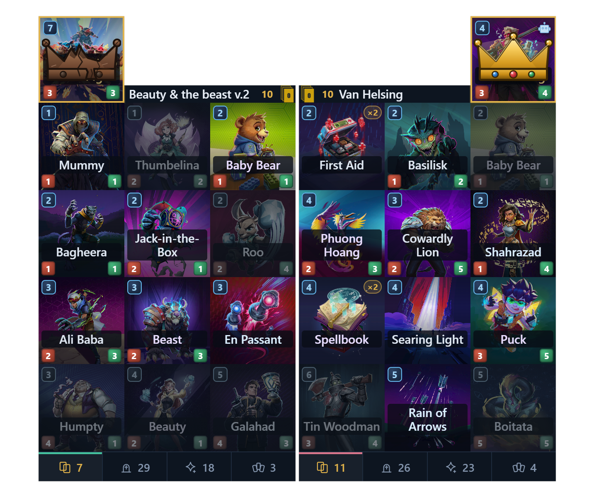

# Origins Deck Tracker

A lightweight, live deck tracker for **Origins TCG** — both players' zones, remaining decklists and card art in a small overlay beside the game.

Origins Deck Tracker sits next to Origins TCG and shows the match as it happens: your hand, your deck, both graveyards, what has been created, and how much of each decklist is left. Two slim sheets follow the game window, one per player, with the same tabs, card faces and hover cards. When the match ends, the record stays on your PC.

It is an unofficial fan project by [mega](https://github.com/megablue). Not affiliated with or endorsed by Koin Games.

## What it does

- **Live zones, both sides.** Hand, deck, graveyard and created cards, updated as the match moves. The opponent's sheet mirrors yours, tab for tab.
- **Decklists that add up.** The commander and every remaining copy, counted against what has actually left the deck — not a static list you have to subtract in your head.
- **Card art and full text.** Real illustrations on the tiles and on hover, with the card's rules text, power and health.
- **Mulligan marks.** Your opening hand's keeps and throws are marked on the decklist while the choice is open.
- **A record of every match.** Each game is written to disk as one document — result, zones, decklists, the lot. Nothing is uploaded and nothing needs an account.
- **A home block.** A small tab at the menu shows the tracker is alive and gets out of the way during a match.
- **Out of the way by default.** It starts in the notification area, draws no window until you ask, and the overlay only appears over a live match.

## Built to be trusted

A deck tracker is only useful if you can stop checking it.

- **It reads the match itself, not a picture of it.** No screen scraping, no OCR, no guessing from pixels — the numbers come from the game's own live state, so a resize, a theme or a second monitor cannot change them.
- **The record is written as the match happens.** Sessions survive a crash, a disconnect or an alt-tab, and the final result is filled in when the game reports it.
- **It fails quietly.** If a game update moves something the tracker relies on, the tracker steps back and leaves the game running. A broken tracker is an annoyance; a broken game is not acceptable.

## Small on purpose

Most trackers in this space are Electron apps: they ship a whole Chromium runtime and a Node stack, so a "small" install is still well over a hundred megabytes and idles like a browser.

This one is a native Windows application. It uses the WebView2 runtime Windows already ships for its own windows, so there is no browser to bundle:

| | Origins Deck Tracker | Typical Electron tracker |
| --- | --- | --- |
| Download | ~3 MB | 80–150 MB |
| Installed app | ~12 MB | 150–300 MB |
| Runtime bundled | none (system WebView2) | Chromium + Node |
| Startup | instant, tray-first | app window boots a browser |

Small also means it can stay running all evening without you noticing it.

## Install

1. Download `OriginsDeckTracker_<version>_x64-setup.exe` from [Releases](https://github.com/megablue/OriginsDeckTracker/releases/latest).
2. Run it. It installs per user — no administrator prompt.
3. Launch **Origins Deck Tracker** from the Start menu. It appears in the notification area.
4. The first start offers to set up the game side. Point it at Origins TCG if it does not find the install itself, and let it finish. It may open and close the game a couple of times while it prepares; after that, start the game normally.

The window you want is behind the tray icon: left-click summons the overlay, right-click gives you **Main**, **Settings**, **Set up game**, **Overlay** and **Quit**.

> The installer is not code-signed, so Windows SmartScreen may ask once. Choose **More info → Run anyway**. The download is the same file listed on the Releases page.

## Requirements

- Windows 10 or 11, 64-bit.
- Origins TCG installed through Steam.
- Microsoft Edge WebView2 — already present on Windows 11 and on any Windows 10 with Edge.

## A few honest answers

**Does it change the game or my collection?**
No. It reads the match and draws its own windows. It does not alter cards, rules, decks, matchmaking or your account, and it does not play for you.

**Can I use it in ranked?**
It works in ranked and in bot matches.

**Will I be banned?**
It does not automate input or decisions, and it does not touch the game's files beyond adding the companion piece the installer puts there. It is still an unofficial tool: use it at your own risk.

**Why is the source not here?**
This repository is the release page. The source is private; the installers attached to each release are the whole product.

**Something broke after a game update?**
That is expected occasionally — the tracker is built to go quiet rather than take the game with it. Check the releases page for a newer build, and open an issue with the version shown in the tray tooltip.

## Support the tracker

Origins Deck Tracker is free and it stays that way. It is built and maintained in spare time, and a few things cost real money: the hours that go into keeping it working after every game update, and the server for the online features that are coming next — shared match history, deck stats and more.

If the tracker earns a place in your sessions, please consider chipping in. Every donation goes straight into development and that server bill.

## Feedback

Bug reports and feature requests are welcome in [Issues](https://github.com/megablue/OriginsDeckTracker/issues). Include the tracker version (tray tooltip), what you were doing, and — if you can — the match's session folder name from `%LOCALAPPDATA%\OriginsDeckTracker\sessions`.

---

Origins TCG and its card art belong to Koin Games. This is a community tool by [mega](https://github.com/megablue), provided as is.
